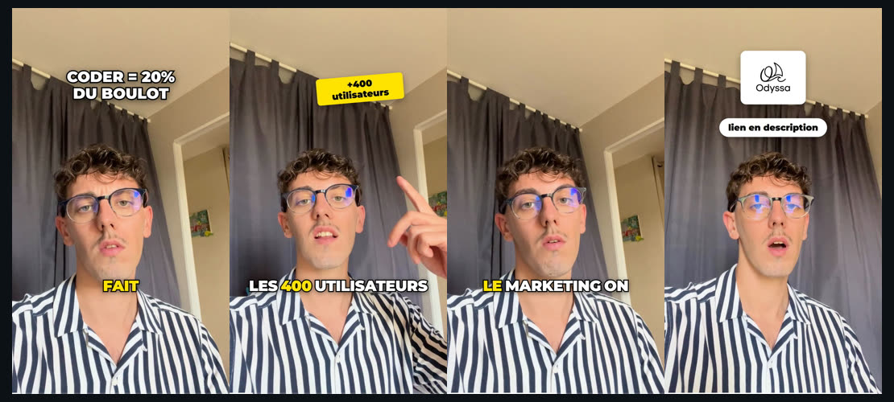

# TikTokEditor

**Un montage vidéo décrit comme un fichier JSON, rendu par Remotion, écrit par Claude.**

Pas de timeline à la souris. Le montage est un document texte : il se génère, se
relit, se corrige d'une ligne, et se reproduit à l'identique.

```
script → rushes → analyse → transcription → plan.json → validation → MP4
```

Le script aussi : sans idée de départ, un thème et deux ou trois axes suffisent
à obtenir le texte à dire et la liste des plans à filmer.

Format de sortie : **1080 × 1920, 30 fps, H.264**, prêt pour TikTok, Reels et
Shorts.



*Une vidéo réelle montée avec cet outil : hook remonté depuis le milieu du rush,
compteur animé calé sur le chiffre prononcé, sous-titres karaoké recalés sur le
remontage, logo et CTA. 95 s de rush ramenées à 51 s, décrites dans un JSON de
120 lignes.*

<!-- REMPLACER : glisser la vidéo dans une issue GitHub pour obtenir une URL,
     ou coller ici le lien TikTok. -->

## À qui ça s'adresse

À toi si tu produis régulièrement de la vidéo verticale et que tu es à l'aise
avec un terminal. Le montage étant un fichier texte, il se versionne, se
duplique d'une vidéo à l'autre, et se corrige sans rouvrir quoi que ce soit.

**Ce n'est pas un remplaçant de CapCut.** Si tu montes une vidéo de temps en
temps à la main, CapCut fera mieux et plus vite. L'intérêt commence quand tu en
produis beaucoup, avec une identité constante, ou quand tu veux qu'un modèle
écrive le montage à ta place.

Sur ce dernier point : le moteur fonctionne seul, mais il est conçu pour que
**[Claude Code](https://claude.com/claude-code) écrive le `plan.json`** à partir
de tes rushes et d'un brief. Sans lui, tu écris le JSON toi-même, ce qui reste
faisable mais nettement moins amusant.

---

## Voir ce que ça produit

```bash
npm install
npm run demo -- --go
```

Génère un projet de démonstration de toutes pièces (rushes, musique, bruitages,
transcription) et le rend. Environ une minute, rien à fournir.

Le montage obtenu utilise à peu près tout le moteur : coupes, Ken Burns,
transitions, sous-titres karaoké, compteur animé, effets de plan, bruitages,
musique. Ouvre `projects/demo/plan.json`, change une ligne, relance
`npm run render -- demo --draft` : c'est tout le principe de l'outil.

---

## Installation

```bash
npm install
```

| Prérequis | Vérifier | Installer |
|---|---|---|
| Node 20+ | `node --version` | [nodejs.org](https://nodejs.org) |
| FFmpeg | `ffmpeg -version` | `winget install Gyan.FFmpeg` |

Chrome Headless Shell (~113 Mo) se télécharge seul au premier rendu.

**Aucune clé API n'est nécessaire.** La transcription tourne en local avec
Whisper.cpp, gratuitement et hors ligne. `OPENAI_API_KEY` est optionnel et sert
uniquement à obtenir un meilleur alignement des sous-titres (environ 1 centime
par vidéo). Copier `.env.example` vers `.env` pour le renseigner.

### Vérifier que tout marche

```bash
npm run doctor
```

Contrôle Node, FFmpeg, le filtre de tone mapping HDR, Remotion, le navigateur de
rendu, les modèles de transcription, l'arborescence et l'espace disque. Chaque
problème est annoncé avec la commande qui le corrige.

```bash
npm run doctor -- --full
```

Ajoute un vrai rendu de bout en bout : génère un rush de test, écrit un montage
minimal, le rend, et nettoie tout derrière. Une minute pour savoir que la chaîne
complète fonctionne sur la machine.

---

## Structure

```
TikTokEditor/
├── projects/              ← TOUT ton contenu, rien n'est versionné
│   ├── _library/          bibliothèque partagée entre tes projets
│   │   ├── sfx/           bruitages
│   │   ├── music/         musiques de fond
│   │   └── brand/         logos
│   └── mon-projet/
│       ├── brief.md       ENTRÉE  ce que la vidéo doit faire
│       ├── script.md      ENTRÉE  le texte à dire, les plans à filmer
│       ├── media/         ENTRÉE  les rushes, jamais modifiés
│       │   └── proxy/     généré  versions allégées
│       ├── media.json     généré  durées et formats réels
│       ├── captions.json  généré  transcription mot à mot
│       └── plan.json      LE MONTAGE
│
├── exports/               SORTIE  tes MP4, pas versionnés non plus
│
├── src/                   le moteur Remotion
├── scripts/               la ligne de commande
├── docs/                  la documentation de référence
└── .claude/skills/        la procédure que suit Claude
```

Deux règles.

**Rien de généré ne sort de `projects/<slug>/` ou de `exports/`.** Un fichier
qui traîne à la racine est un bug.

**Le contenu de `projects/` et de `exports/` n'est jamais versionné.** Tes
rushes, tes briefs, tes transcriptions et tes montages restent chez toi. Si tu
forkes ce dépôt, tu ne publieras rien de ce que tu produis avec.

`projects/` sert de dossier public à Remotion. C'est pourquoi la bibliothèque
partagée vit dedans, sous `_library/` : elle est servie au rendu sans être
dupliquée dans chaque projet.

---

## Monter une vidéo

Le fil ci-dessous prend un exemple, `vlog-lisbonne`. Remplace-le par le nom de
ton projet. Chaque commande est indépendante : tu peux en relancer une sans
recommencer les précédentes.

### 0. Pas d'idée ? Le script s'écrit avant les rushes

Donne un thème et des axes à Claude : « écris-moi un script sur trois jours à
Lisbonne à moins de 200 euros, axes transport, logement, où manger ». Il propose
trois angles, tu en choisis un, et il écrit `projects/vlog-lisbonne/script.md` :
le texte à dire bloc par bloc, et en face de chacun le plan à filmer.

```bash
npm run script -- vlog-lisbonne
```

Compte les mots, les convertit en secondes de parole et dit lesquels ne
tiendront pas dans le temps annoncé, puis sort la liste des plans à tourner. Un
bloc de 6 secondes ne contient pas 25 mots, et il vaut mieux l'apprendre avant
d'allumer la caméra. Détail dans [docs/SCRIPT.md](docs/SCRIPT.md).

Si tu as déjà tes rushes, saute cette étape.

### 1. Créer le projet

```bash
npm run new -- vlog-lisbonne
```

Crée le dossier avec un `plan.json` vide et un `brief.md` à remplir.

### 2. Déposer les rushes

Dans `projects/vlog-lisbonne/media/` : clips, photos, voix off. Les
sous-dossiers sont acceptés.

### 3. Analyser

```bash
npm run ingest -- vlog-lisbonne
```

Écrit `media.json` : durée, dimensions, orientation, présence d'audio. **C'est
ce que Claude lit pour ne pas inventer de durées.** La commande signale aussi les
rushes trop lourds pour un rendu direct.

### 4. Alléger si nécessaire

```bash
npm run proxy -- vlog-lisbonne
```

Une vidéo de téléphone est en 4K HEVC 60 fps, souvent en HDR. Remotion n'arrive
pas à en extraire les frames assez vite, et le HDR converti sans tone mapping
donne des couleurs fausses. Le proxy règle les deux : H.264 1080 × 1920 30 fps,
tone mapping HDR vers SDR BT.709. **Les originaux ne sont jamais touchés.**

### 5. Transcrire

```bash
npm run transcribe -- vlog-lisbonne                    # Whisper local, gratuit
npm run transcribe -- vlog-lisbonne --openai           # mieux aligné, ~1 centime
npm run transcribe -- vlog-lisbonne --srt fichier.srt  # import d'un .srt
```

Écrit `captions.json` : chaque mot avec son timing. Sert aux sous-titres karaoké
**et** au ducking automatique de la musique.

### 6. Repérer les silences

```bash
npm run cuts -- vlog-lisbonne
```

Liste les endroits où couper sans manger un mot. Étape courte et décisive :
c'est elle qui fait la différence entre un montage propre et des coupes qui
ressemblent à des bugs. Voir [docs/MONTAGE.md](docs/MONTAGE.md).

### 7. Écrire le montage

C'est l'étape où tu décides. Deux façons de faire.

**Avec Claude Code**, la façon prévue : remplis `brief.md`, puis demande

> Monte vlog-lisbonne. Hook sur la vue du belvédère, 30 s max, CTA à la fin.

Il lit `media.json`, `captions.json`, les silences et ton brief, écrit
`plan.json`, le valide et le rend. La procédure qu'il suit est versionnée dans
[.claude/skills/tiktok-montage/SKILL.md](.claude/skills/tiktok-montage/SKILL.md) :
c'est un fichier comme un autre, adapte-le à ton style de montage.

**À la main**, si tu n'utilises pas Claude Code : ouvre `plan.json` et écris les
clips. [docs/PLAN.md](docs/PLAN.md) documente chaque champ, et
`npm run validate` t'arrête sur toute incohérence avant le rendu.

### 8. Regarder et corriger

```bash
npm run studio -- --props='{"project":"vlog-lisbonne"}'
```

Le Studio Remotion s'ouvre : timeline, lecture, scrub. Après modification de
`plan.json`, cliquer sur rafraîchir.

### 9. Itérer sans attendre

```bash
npm run render -- vlog-lisbonne --draft
npm run render -- vlog-lisbonne --draft --from 20 --to 35
```

`--draft` rend en 540 × 960 à 15 fps : **2,7 fois plus rapide et 19 fois plus
léger** qu'un rendu final. On n'y juge pas la qualité d'image, on y juge le
montage, le rythme, les coupes, la synchro des sous-titres. C'est ce qu'on
regarde vingt fois avant le rendu final, qu'on ne lance qu'une seule.

`--from` et `--to`, en secondes, ne rendent que le passage sur lequel on
travaille. Les deux se combinent : 15 s de brouillon sortent en moins d'une
minute.

Un brouillon ou un extrait ne reçoit pas de `plan.json` archivé à côté : seul un
rendu final complet est un livrable.

### 10. Rendre

```bash
npm run render -- vlog-lisbonne
```

Sort `exports/vlog-lisbonne.mp4`, accompagné de
`exports/vlog-lisbonne.plan.json` : on sait toujours de quel montage vient un
fichier livré.

---

## Les commandes

| Commande | Rôle |
|---|---|
| `npm run doctor` | Vérifie que la machine peut faire tourner l'outil |
| `npm run demo` | Génère un projet de démonstration complet |
| `npm run new -- <slug>` | Crée un projet |
| `npm run script -- <slug>` | Vérifie le script : durée de parole, plans à filmer |
| `npm run ingest -- <slug>` | Analyse les rushes → `media.json` |
| `npm run proxy -- <slug>` | Transcode les rushes lourds (4K, HEVC, HDR, 60 fps) |
| `npm run transcribe -- <slug>` | Transcrit la voix → `captions.json` |
| `npm run cuts -- <slug>` | Liste les silences : où couper sans manger un mot |
| `npm run sfx` | Explore la bibliothèque de bruitages |
| `npm run validate -- <slug>` | Vérifie le plan avant rendu |
| `npm run render -- <slug>` | Rend en MP4 |
| `npm run studio` | Ouvre le Studio Remotion |
| `npm test` | Teste la logique de montage |
| `npm run typecheck` | Vérifie le code TypeScript |

Options utiles :

```bash
npm run render -- <slug> --draft --from 20 --to 35
npm run render -- <slug> --out C:/chemin/final.mp4 --crf 23 --concurrency 4
npm run transcribe -- <slug> --model large-v3 --lang fr --audio media/voix.mp3
npm run cuts -- <slug> --around 12.05 --min 0.3
npm run script -- <slug> --debit 2.6 --json
npm run proxy -- <slug> --force
npm run sfx -- whoosh
npm run doctor -- --full
```

---

## Ce que sait faire le moteur

**Image**, découpe et réordonnancement, vitesse, Ken Burns, recadrage, miroir,
filtres CSS, transitions (fade, whip, zoom-punch, slides).

**Textes**, presets prêts à l'emploi (hook, sticker, label, CTA), polices
Montserrat / Anton / Bebas, animations d'entrée et de sortie.

**Compteurs animés**, un chiffre qui monte et atteint sa valeur pile quand il
est prononcé.

**Images**, logos et captures, avec pastille de fond optionnelle pour rester
lisibles sur n'importe quel arrière-plan.

**Sous-titres**, karaoké mot à mot, quatre styles, recalage automatique sur le
remontage, correction de lexique, jamais à cheval sur une coupe.

**Son**, voix, musique avec ducking automatique sur la parole, bruitages placés
à la milliseconde avec compensation de l'attaque.

**Effets**, pulse, shake, flash, calibrés pour se sentir plutôt que se voir.

La référence complète de chaque champ est dans [docs/PLAN.md](docs/PLAN.md).

---

## Documentation

| Document | Contenu |
|---|---|
| [docs/SCRIPT.md](docs/SCRIPT.md) | Le `script.md` : écrire ce qu'on va dire et filmer |
| [docs/PLAN.md](docs/PLAN.md) | Référence complète du `plan.json`, champ par champ |
| [docs/MONTAGE.md](docs/MONTAGE.md) | La méthode : où couper, quoi garder, quoi jeter |
| [docs/DEPANNAGE.md](docs/DEPANNAGE.md) | Chaque erreur rencontrée et sa correction |
| [CLAUDE.md](CLAUDE.md) | Les règles permanentes du projet |
| [src/schema.ts](src/schema.ts) | La grammaire du plan, qui fait autorité |

---

## Licence

Le code est sous [licence MIT](LICENSE) : fais-en ce que tu veux.

**Les fichiers de `projects/_library/` n'en font pas partie** et ne sont pas
dans le dépôt. Bruitages, musiques et logos viennent de banques tierces dont les
conditions varient. Voir [projects/_library/LICENCES.md](projects/_library/LICENCES.md).

L'image de `docs/images/` n'est pas non plus couverte : c'est une capture d'une
vidéo personnelle, tous droits réservés.

---

## Retours bienvenus

Ce dépôt est public pour être critiqué. Ce qui m'intéresse en particulier :

- **ce qui casse chez toi.** `npm run doctor` puis `npm run doctor -- --full`
  donnent un diagnostic complet, colle-le dans une issue
- **les montages ratés.** Si le moteur produit quelque chose de moche, le
  `plan.json` qui l'a produit suffit à reproduire
- **ce qui manque au schéma.** Un champ absent est un montage impossible

Le dépôt ne contient que du texte : une quarantaine de fichiers, environ 350 Ko.
Aucun projet, aucun rush, aucun rendu. `npm run demo -- --go` fabrique tout ce
qu'il faut sur place, donc rien à télécharger pour essayer.

---

## Modifier le rendu visuel

Le plan décrit *quoi* montrer. Les composants décrivent *comment*.

| À changer | Fichier |
|---|---|
| Style des sous-titres | [src/components/Captions.tsx](src/components/Captions.tsx) |
| Presets de texte, images, compteurs | [src/components/Overlays.tsx](src/components/Overlays.tsx) |
| Ken Burns, recadrage, filtres | [src/components/ClipTrack.tsx](src/components/ClipTrack.tsx) |
| Ducking, fondu musique | [src/components/AudioTrack.tsx](src/components/AudioTrack.tsx) |
| Effets de plan | [src/components/Effects.tsx](src/components/Effects.tsx) |
| Bruitages | [src/components/SfxTrack.tsx](src/components/SfxTrack.tsx) |
| Transitions | [src/lib/animations.ts](src/lib/animations.ts) |
| Nouveaux champs du plan | [src/schema.ts](src/schema.ts) |

Ajouter un champ au schéma le rend immédiatement disponible à Claude : la skill
renvoie vers `src/schema.ts` comme source de vérité.
